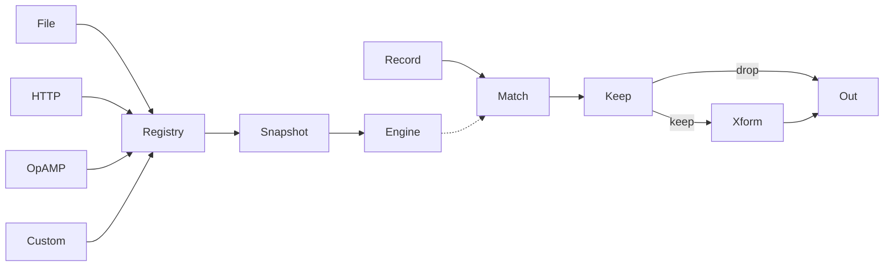
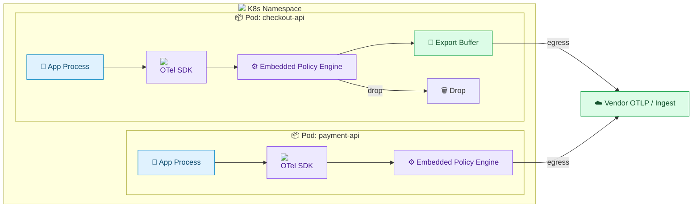
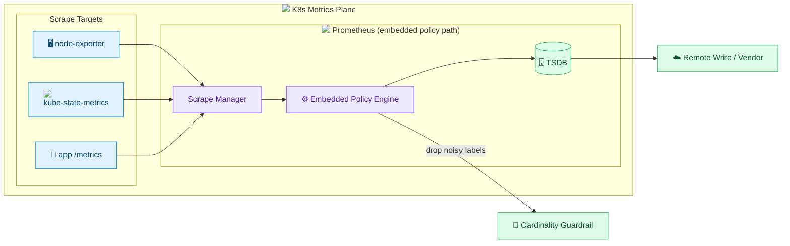
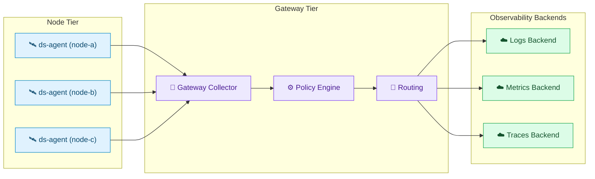
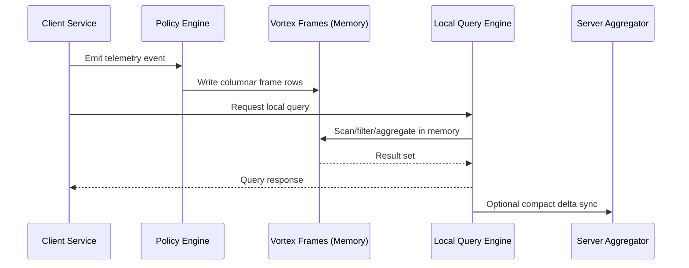

# New Approaches for Telemetry Management

### AltCloud April 2026 Meetup

---

# Jacob Aronoff

<div class="mt-6 grid grid-cols-[180px_1fr] gap-8 items-center">
  <div class="flex justify-center">
    
  </div>
  <div class="text-left space-y-3">
    <div class="rounded-lg border border-blue-200/35 bg-blue-50/10 px-3 py-2">
      <div class="text-[11px] uppercase tracking-wider opacity-75">Role</div>
      <div class="font-semibold">Founding Engineer at Tero</div>
    </div>
    <div class="rounded-lg border border-blue-200/35 bg-blue-50/10 px-3 py-2">
      <div class="text-[11px] uppercase tracking-wider opacity-75">Role</div>
      <div class="font-semibold">OpenTelemetry Maintainer</div>
      <div class="mt-2 grid grid-cols-2 gap-2 text-sm">
        <div class="rounded-md border border-slate-300/40 bg-slate-50/10 px-2 py-1">Operator</div>
        <div class="rounded-md border border-slate-300/40 bg-slate-50/10 px-2 py-1">Helm Charts</div>
        <div class="rounded-md border border-slate-300/40 bg-slate-50/10 px-2 py-1">Remote Mgmt</div>
        <div class="rounded-md border border-slate-300/40 bg-slate-50/10 px-2 py-1">Injection</div>
      </div>
    </div>
    <div class="rounded-lg border border-blue-200/35 bg-blue-50/10 px-3 py-2">
      <div class="text-[11px] uppercase tracking-wider opacity-75">Contact</div>
      <div class="font-semibold text-sm">jacob@usetero.com</div>
    </div>
  </div>
</div>

---
transition: fade
---

# Brief History of Observability

- Logs first: raw event streams for debugging
- Metrics next: cheap trend visibility and alerting
- Traces next: request-level causality across services
- Today: all three are necessary, but operationally fragmented

<div class="cd-timeline">
  <span class="cd-chip cd-chip-active">Logs</span>
  <span class="cd-timeline-line"></span>
  <span class="cd-chip cd-chip-inactive">Prometheus</span>
  <span class="cd-timeline-line"></span>
  <span class="cd-chip cd-chip-inactive">OTel Traces</span>
  <span class="cd-timeline-line"></span>
  <span class="cd-chip cd-chip-inactive">OTel Unified</span>
</div>

---
transition: fade
---

# From Logs to Metrics (Prometheus)

- Logs gave detail, but weak aggregation and high storage cost
- Prometheus normalized metric collection and alerting at scale as Kubernetes
  became the industry standard
- Prometheus management can be incredibly challenging at scale, requiring
  complex architectures to prevent cardinality explosion, OOMs, etc.

<div class="cd-timeline">
  <span class="cd-chip cd-chip-inactive">Logs</span>
  <span class="cd-timeline-line"></span>
  <span class="cd-chip cd-chip-active">Prometheus</span>
  <span class="cd-timeline-line"></span>
  <span class="cd-chip cd-chip-inactive">OTel Traces</span>
  <span class="cd-timeline-line"></span>
  <span class="cd-chip cd-chip-inactive">OTel Unified</span>
</div>

---
transition: fade
---

# From Metrics to Traces (OpenTelemetry)

- Distributed systems forced request-path debugging
- Tracing became the model for latency + dependency analysis
- OpenTelemetry standardized collection across vendors
- Metrics/logs/traces now share common resource and attribute semantics

<div class="cd-timeline">
  <span class="cd-chip cd-chip-inactive">Logs</span>
  <span class="cd-timeline-line"></span>
  <span class="cd-chip cd-chip-inactive">Prometheus</span>
  <span class="cd-timeline-line"></span>
  <span class="cd-chip cd-chip-active">OTel Traces</span>
  <span class="cd-timeline-line"></span>
  <span class="cd-chip cd-chip-inactive">OTel Unified</span>
</div>

---
transition: fade
---

# OTel as the Unifying Layer

- Adoption trend: OTel increasingly wraps all telemetry flows
- Logs + metrics + traces converge around one instrumentation model
- Collector and SDK ecosystem becoming default data plane
- Profiles are being introduced soon too!
- Control gaps now become the next bottleneck

<div class="cd-timeline">
  <span class="cd-chip cd-chip-inactive">Logs</span>
  <span class="cd-timeline-line"></span>
  <span class="cd-chip cd-chip-inactive">Prometheus</span>
  <span class="cd-timeline-line"></span>
  <span class="cd-chip cd-chip-inactive">OTel Traces</span>
  <span class="cd-timeline-line"></span>
  <span class="cd-chip cd-chip-active">OTel Unified</span>
</div>

---

# OTel Adoption

<div class="mt-4 w-full flex justify-center">
  
</div>

---

# Major Issues Today

- Cost dominates every architectural decision
- Conventions are fragmented across tools and teams
- Volume growth outpaces human reasoning and pipeline design
- Result: teams optimize plumbing instead of understanding systems

---

# Cost

<div class="grid grid-cols-3 gap-5 text-left text-[13px] leading-5 mt-2">
  <div
    v-motion
    :initial="{ y: 20, opacity: 0 }"
    :enter="{ y: 0, opacity: 1, transition: { duration: 500 } }"
    class="rounded-xl cd-cost-card cd-cost-card-red p-4"
  >
    <h3 class="text-sm uppercase tracking-wider cd-cost-title mb-3">Debug Log Accident</h3>
    <div class="border-l-2 cd-cost-track pl-3 space-y-3">
      <p v-click class="relative"><span class="absolute -left-[17px] top-1.5 w-2 h-2 rounded-full cd-cost-dot" />Debug log intended for dev only.</p>
      <p v-click class="relative"><span class="absolute -left-[17px] top-1.5 w-2 h-2 rounded-full cd-cost-dot" />Config leak deploys it to prod.</p>
      <p v-click class="relative"><span class="absolute -left-[17px] top-1.5 w-2 h-2 rounded-full cd-cost-dot" />Log volume spikes in hot paths.</p>
      <p v-click class="relative"><span class="absolute -left-[17px] top-1.5 w-2 h-2 rounded-full cd-cost-dot-strong" /><span v-mark.red>Ingest cost explodes</span> before anyone catches it.</p>
    </div>
  </div>

  <div
    v-motion
    :initial="{ y: 20, opacity: 0 }"
    :enter="{ y: 0, opacity: 1, transition: { duration: 500, delay: 150 } }"
    class="rounded-xl cd-cost-card cd-cost-card-orange p-4"
  >
    <h3 class="text-sm uppercase tracking-wider cd-cost-title mb-3">AI PR Cardinality Blast</h3>
    <div class="border-l-2 cd-cost-track pl-3 space-y-3">
      <p v-click class="relative"><span class="absolute -left-[17px] top-1.5 w-2 h-2 rounded-full cd-cost-dot" />AI-generated PR adds high-cardinality labels.</p>
      <p v-click class="relative"><span class="absolute -left-[17px] top-1.5 w-2 h-2 rounded-full cd-cost-dot" />Cardinality ramps rapidly in production.</p>
      <p v-click class="relative"><span class="absolute -left-[17px] top-1.5 w-2 h-2 rounded-full cd-cost-dot" />Prometheus / Datadog Agent gets overloaded.</p>
      <p v-click class="relative"><span class="absolute -left-[17px] top-1.5 w-2 h-2 rounded-full cd-cost-dot-strong" /><span v-mark.orange>Reliability drops + cost spikes</span> at the same time.</p>
    </div>
  </div>

  <div
    v-motion
    :initial="{ y: 20, opacity: 0 }"
    :enter="{ y: 0, opacity: 1, transition: { duration: 500, delay: 300 } }"
    class="rounded-xl cd-cost-card cd-cost-card-purple p-4"
  >
    <h3 class="text-sm uppercase tracking-wider cd-cost-title mb-3">Renewal Trap</h3>
    <div class="border-l-2 cd-cost-track pl-3 space-y-3">
      <p v-click class="relative"><span class="absolute -left-[17px] top-1.5 w-2 h-2 rounded-full cd-cost-dot" />Datadog overages keep repeating.</p>
      <p v-click class="relative"><span class="absolute -left-[17px] top-1.5 w-2 h-2 rounded-full cd-cost-dot" />SRE/Ops spends a month cleaning pipelines.</p>
      <p v-click class="relative"><span class="absolute -left-[17px] top-1.5 w-2 h-2 rounded-full cd-cost-dot" />Usage improves, dashboards stabilize.</p>
      <p v-click class="relative"><span class="absolute -left-[17px] top-1.5 w-2 h-2 rounded-full cd-cost-dot-strong" /><span v-mark.purple>Renewal still comes in higher.</span></p>
    </div>
  </div>
</div>

<div v-click class="mt-3 text-xs opacity-70">
  Different incidents, same outcome: surprise spend and engineering drag.
</div>

---

# Conventions

Same intent: drop telemetry when `user_id` is present.

<div class="grid grid-cols-2 gap-4 text-left mt-2">
<div>

```yaml [OTTL] {all|4|all}
processors:
  filter:
    metrics:
      datapoint:
        - 'attributes["user_id"] != nil'
```

</div>
<div>

```yaml [Prometheus] {all|3|all}
metric_relabel_configs:
  - source_labels: [user_id]
    regex: ".+"
    action: drop
```

</div>
<div>

```toml [VRL] {all|4|all}
[transforms.drop_user_id]
type = "filter"
inputs = ["source"]
condition = '!exists(.tags.user_id)'
```

</div>
<div>

```lua [FluentBit Lua] {all|2|all}
function cb_filter(tag, timestamp, record)
  if record["user_id"] ~= nil then
    return -1, 0, 0
  end
  return 0, 0, record
end
```

</div>
</div>

---

# Volume

<div class="mt-2 space-y-3 text-left">
  <div class="rounded-lg border border-slate-300 p-3" v-click>
    <div class="flex items-center justify-between text-sm">
      <strong>Stage 1: New Services</strong>
      <span class="opacity-70">Volume: 1x</span>
    </div>
    <div class="mt-2 h-3 bg-slate-200 rounded">
      <div class="h-3 w-[30%] bg-blue-500 rounded"></div>
    </div>
    <div class="mt-2 text-xs opacity-80">Signal-to-noise: <span class="text-green-700 font-semibold">Healthy</span></div>
  </div>

  <div class="rounded-lg border border-slate-300 p-3" v-click>
    <div class="flex items-center justify-between text-sm">
      <strong>Stage 2: Add New Region</strong>
      <span class="opacity-70">Volume: 3x</span>
    </div>
    <div class="mt-2 h-3 bg-slate-200 rounded">
      <div class="h-3 w-[60%] bg-orange-500 rounded"></div>
    </div>
    <div class="mt-2 text-xs opacity-80">Signal-to-noise: <span class="text-amber-700 font-semibold">Degrading</span></div>
  </div>

  <div class="rounded-lg border border-slate-300 p-3" v-click>
    <div class="flex items-center justify-between text-sm">
      <strong>Stage 3: Add New Workloads (AI, batch, edge)</strong>
      <span class="opacity-70">Volume: 10x+</span>
    </div>
    <div class="mt-2 h-3 bg-slate-200 rounded">
      <div class="h-3 w-[95%] bg-red-500 rounded"></div>
    </div>
    <div class="mt-2 text-xs opacity-80">Signal-to-noise: <span class="text-red-700 font-semibold">Out of whack</span></div>
  </div>
</div>

<div v-click class="mt-3 text-sm opacity-75">
  More telemetry is not the problem by itself. Unmanaged growth without consistent control is.
</div>

---

# AI Coding Era: Why It Gets Worse

<div class="grid grid-cols-2 gap-6 mt-2">
  <div class="text-left">
    <ul class="space-y-3 text-sm leading-6">
      <li v-click>AI-generated code increases service and workload churn, so telemetry shape changes constantly.</li>
      <li v-click>Teams ship faster, but observability conventions and ownership do not keep pace.</li>
      <li v-click>High-cardinality metrics and verbose logs spread quickly through copied AI patterns.</li>
      <li v-click>Only a small group can debug incidents end-to-end, creating an operational bottleneck.</li>
    </ul>
  </div>
  <div class="space-y-4">
    <blockquote
      v-click
      v-motion
      :initial="{ opacity: 0, x: 25 }"
      :enter="{ opacity: 1, x: 0 }"
      class="rounded-lg border-l-4 border-red-500 bg-red-50 p-4 text-sm text-left"
    >
      "Our logging volume has gone from 1 petabyte to 40 petabytes per day" <br>
      <span class="text-xs opacity-75">- VP at FAANG company</span>
    </blockquote>
    <blockquote
      v-click
      v-motion
      :initial="{ opacity: 0, x: 25 }"
      :enter="{ opacity: 1, x: 0, transition: { delay: 150 } }"
      class="rounded-lg border-l-4 border-amber-500 bg-amber-50 p-4 text-sm text-left"
    >
      "We're shipping faster than ever, but our incident rate keeps climbing and only a few people know how to fix it" <br>
      <span class="text-xs opacity-75">- head of SRE at an Infra provider</span>
    </blockquote>
  </div>
</div>

---

# Motivation

<div class="grid grid-cols-2 gap-5 mt-2 text-left text-sm">
  <div class="rounded-xl border border-rose-200 bg-rose-50 p-4">
    <div class="font-semibold mb-2">1) Configurations grow organically</div>
    <ul class="raw-list list-disc pl-5 space-y-1">
      <li>Pipeline config starts small, then grows to thousands of lines.</li>
      <li>Each line solved a past incident, but the reasoning is no longer visible.</li>
      <li>Changes become risky because config encodes hidden institutional knowledge.</li>
    </ul>
  </div>
  <div class="rounded-xl border border-orange-200 bg-orange-50 p-4">
    <div class="font-semibold mb-2">2) Changes require global reasoning</div>
    <ul class="raw-list list-disc pl-5 space-y-1">
      <li>To edit one rule safely, you must understand the full DAG.</li>
      <li>As config grows, cognitive load rises and reviews get superficial.</li>
      <li>Controlling servers must parse each component's config semantics.</li>
    </ul>
  </div>
</div>

<div class="grid grid-cols-2 gap-5 mt-4 text-left text-sm">
  <div class="rounded-xl border border-amber-200 bg-amber-50 p-4">
    <div class="font-semibold mb-2">3) Configurations do not scale</div>
    <ul class="raw-list list-disc pl-5 space-y-1">
      <li>100 noisy patterns is feasible.</li>
      <li>1,000 degrades performance.</li>
      <li>10,000 is impractical in sequential pipelines, so teams over-drop and lose signal.</li>
    </ul>
  </div>
  <div class="rounded-xl border border-violet-200 bg-violet-50 p-4">
    <div class="font-semibold mb-2">4) Remote control lacks guarantees</div>
    <ul class="raw-list list-disc pl-5 space-y-1">
      <li>Dynamic behavior is not guaranteed with file-based config + OpAMP paths.</li>
      <li>Collector distributions can define custom config formats.</li>
      <li>A controller cannot assume one universal, safe runtime update model.</li>
    </ul>
  </div>
</div>

---

# Policies

<div class="grid grid-cols-3 gap-4 mt-2 text-left text-sm">
  <div class="rounded-xl border border-blue-200 bg-blue-50 p-4">
    <div class="text-xs uppercase tracking-wider text-blue-700 mb-2">Contract</div>
    <div class="font-semibold">Atomic intent</div>
    <div class="opacity-80">One matcher set + one action set.</div>
  </div>
  <div class="rounded-xl border border-violet-200 bg-violet-50 p-4">
    <div class="text-xs uppercase tracking-wider text-violet-700 mb-2">Typing</div>
    <div class="font-semibold">One signal target</div>
    <div class="opacity-80"><code>log</code> / <code>metric</code> / <code>trace</code> via <code>oneof</code>.</div>
  </div>
  <div class="rounded-xl border border-emerald-200 bg-emerald-50 p-4">
    <div class="text-xs uppercase tracking-wider text-emerald-700 mb-2">Portability</div>
    <div class="font-semibold">OTel data model fields</div>
    <div class="opacity-80">Same policy behavior in SDK, collector, proxy.</div>
  </div>
</div>

<div class="grid grid-cols-2 gap-4 mt-4 text-left text-sm">
  <div class="rounded-xl border border-slate-300 p-4">
    <div class="font-semibold mb-2">Spec Guarantees</div>
    <div class="flex flex-wrap gap-2">
      <span class="cd-pill">self-contained</span>
      <span class="cd-pill">idempotent</span>
      <span class="cd-pill">fail-open</span>
      <span class="cd-pill">deterministic</span>
    </div>
  </div>
  <div class="rounded-xl border border-slate-300 p-4">
    <div class="font-semibold mb-2">Non-Goals</div>
    <div class="opacity-80">Policies define outcomes, not runtime wiring, transport, or component-specific config.</div>
  </div>
</div>

---

# Policy Architecture



---

# Example Policy

```json [drop-debug-logs.policy.json]
{
  "id": "drop-debug-logs",
  "name": "Drop debug and trace logs",
  "log": {
    "match": [
      {
        "log_field": "severity_text",
        "regex": "^(DEBUG|TRACE)$"
      }
    ],
    "keep": "none"
  }
}
```

- Single intent, reusable everywhere in the telemetry path

---

# Go Sample

```go [go] {all|1-3|5-8|all}
registry := policy.NewPolicyRegistry()
provider := policy.NewFileProvider("policies.json")
defer provider.Stop()

handle, err := registry.Register(provider)
if err != nil { log.Fatal(err) }
defer handle.Unregister()

engine := policy.NewPolicyEngine(registry)
result := policy.EvaluateLog(engine, record, matchLog)
fmt.Printf("Result: %s\n", result)
```

Source: `github.com/usetero/policy-go` README Quick Start

---

# Rust Sample

```rust [rust] {all|1-4|6-11|all}
let registry = PolicyRegistry::new();
let provider = FileProvider::new("policies.json");
registry.subscribe(&provider)?;

let engine = PolicyEngine::new();
let snapshot = registry.snapshot();
let result = engine.evaluate(&snapshot, &log).await?;
match result {
    EvaluateResult::Drop { policy_id } => println!("Drop: {}", policy_id),
    _ => println!("Pass through"),
}
```

Source: `github.com/usetero/policy-rs` README Quick Start

---

# Zig Sample

```zig [zig] {all|1-4|6-9|11-14|all}
const policy = @import("policy_zig");

var registry = policy.Registry.init(allocator, bus);
defer registry.deinit();

const file_provider = try policy.FileProvider.init(allocator, bus, .{
    .id = "local",
    .path = "policies.json",
});
defer file_provider.deinit();
try registry.subscribe(.{ .file = file_provider });

var engine = try policy.PolicyEngine.init(allocator, &registry);
defer engine.deinit();
const outcome = try engine.evaluate(&record, accessor);
if (outcome.drop) return;
```

Source: `github.com/usetero/policy-zig` README Library Usage

---
transition: slide-left
---

# Hyperscan Optimization Trick

<div class="grid grid-cols-2 gap-6 items-center mt-2">
  <div class="text-left text-sm grid gap-2">
    <div v-click class="rounded-lg border border-blue-200 bg-blue-50 p-3">Compile policy regexes ahead-of-time into Hyperscan databases grouped by match type.</div>
    <div v-click class="rounded-lg border border-violet-200 bg-violet-50 p-3">At runtime, evaluate the relevant field against compiled databases in parallel.</div>
    <div v-click class="rounded-lg border border-amber-200 bg-amber-50 p-3">Handle negated matchers with a separate negation path and short-circuit behavior.</div>
    <div v-click class="rounded-lg border border-slate-300 bg-slate-50 p-3">Use preallocated Hyperscan scratch memory to avoid hot-path allocations.</div>
  </div>
  <div class="flex justify-center">
    
  </div>
</div>

---
transition: slide-left
---

# Architecture: SDK Augmentation



<div class="grid grid-cols-3 gap-3 mt-3 text-xs text-left">
  <div v-click class="rounded-lg border border-blue-200 bg-blue-50 p-3">Evaluate policies in-process for dynamic filtering.</div>
  <div v-click class="rounded-lg border border-violet-200 bg-violet-50 p-3">Apply transforms before data leaves the service.</div>
  <div v-click class="rounded-lg border border-emerald-200 bg-emerald-50 p-3">Fast feedback loops without collector-only dependency.</div>
</div>

---
transition: fade
---

# Architecture: Prometheus Augmentation



<div class="grid grid-cols-3 gap-3 mt-3 text-xs text-left">
  <div v-click class="rounded-lg border border-blue-200 bg-blue-50 p-3">Prometheus streams samples through policy evaluation before persistence.</div>
  <div v-click class="rounded-lg border border-violet-200 bg-violet-50 p-3">High-cardinality attributes are dropped or constrained dynamically.</div>
  <div v-click class="rounded-lg border border-emerald-200 bg-emerald-50 p-3">Prevents memory pressure and runaway cardinality explosions.</div>
</div>

---
transition: slide-up
---

# Architecture: Egress Gateway Conformance



<div class="grid grid-cols-3 gap-3 mt-3 text-xs text-left">
  <div v-click class="rounded-lg border border-blue-200 bg-blue-50 p-3">Daemonsets forward telemetry to a centralized gateway collector.</div>
  <div v-click class="rounded-lg border border-violet-200 bg-violet-50 p-3">Gateway enforces deliberate sampling and policy-based filtering.</div>
  <div v-click class="rounded-lg border border-emerald-200 bg-emerald-50 p-3">Gateway routes normalized telemetry to the correct backend destinations.</div>
</div>

---

<div class="h-full w-full flex items-center justify-center">
  <h1 class="text-7xl font-bold tracking-tight">Demo Time</h1>
</div>

---

# Future Experiments

<div class="grid grid-cols-2 gap-6 items-center mt-2">
  <div class="grid gap-2 text-left text-sm">
    <div class="rounded-lg border border-blue-200 bg-blue-50 p-3">
      Extend policy actions beyond filter/sample/transform into richer analysis and control primitives.
    </div>
    <div class="rounded-lg border border-violet-200 bg-violet-50 p-3">
      Improve policy distribution with precompiled snapshots and safer incremental rollouts.
    </div>
    <div class="rounded-lg border border-amber-200 bg-amber-50 p-3">
      Push evaluation closer to sources and cluster boundaries to reduce egress and response time.
    </div>
    <div class="rounded-lg border border-emerald-200 bg-emerald-50 p-3">
      Use results from local and in-cluster analysis to assist policy generation loops.
    </div>
  </div>
</div>

---

# Vortex Dataframes

<div class="grid grid-cols-2 gap-6 items-center mt-2">
  <div class="grid gap-2 text-left text-sm">
    <div class="rounded-lg border border-blue-200 bg-blue-50 p-3">
      Augment the policy engine with a columnar write path for telemetry records.
    </div>
    <div class="rounded-lg border border-violet-200 bg-violet-50 p-3">
      Columnar data improves filter/transform throughput by operating on contiguous fields.
    </div>
    <div class="rounded-lg border border-amber-200 bg-amber-50 p-3">
      Aggregations are easier to express and faster to execute over typed columns.
    </div>
    <div class="rounded-lg border border-emerald-200 bg-emerald-50 p-3">
      Better compression and better queryability for historical telemetry.
    </div>
  </div>
  <div class="flex justify-center">
    <div class="rounded-xl bg-white p-4 shadow-md">
    
    </div>
  </div>
</div>

---

# On-Device Querying



<div class="grid grid-cols-2 gap-3 text-left text-sm mt-3">
  <div
    v-motion
    :initial="{ y: 14, opacity: 0 }"
    :enter="{ y: 0, opacity: 1 }"
    class="rounded-lg border border-blue-200 bg-blue-50 p-3 shadow-sm"
  >
    Policy engine writes telemetry into in-memory Vortex frames instead of row events.
  </div>
  <div
    v-motion
    :initial="{ y: 14, opacity: 0 }"
    :enter="{ y: 0, opacity: 1, transition: { delay: 120 } }"
    class="rounded-lg border border-violet-200 bg-violet-50 p-3 shadow-sm"
  >
    Local query engine runs filters and aggregations directly over typed columns.
  </div>
  <div
    v-motion
    :initial="{ y: 14, opacity: 0 }"
    :enter="{ y: 0, opacity: 1, transition: { delay: 240 } }"
    class="rounded-lg border border-emerald-200 bg-emerald-50 p-3 shadow-sm"
  >
    Only compact query results/deltas sync upstream, reducing latency and egress.
  </div>
  <div
    v-motion
    :initial="{ y: 14, opacity: 0 }"
    :enter="{ y: 0, opacity: 1, transition: { delay: 360 } }"
    class="rounded-lg border border-amber-200 bg-amber-50 p-3 shadow-sm"
  >
    Tradeoff: client memory pressure and distributed consistency become harder.
  </div>
</div>

---
layout: center
class: text-center
---

# Wrap Up

<div class="mt-4 text-left max-w-5xl mx-auto space-y-4">
  <div class="rounded-xl border border-blue-200 bg-blue-50/80 p-4 grid grid-cols-[1fr_250px] gap-4 items-center shadow-sm">
    <div class="min-w-0">
      <div class="text-xs uppercase tracking-wide text-blue-700 font-semibold">Blog</div>
      <div class="mt-2 text-lg leading-snug font-semibold">
        <a href="https://usetero.com/blog/policies-introduction" target="_blank">Policies Introduction</a>
      </div>
      <div class="text-sm text-blue-800/80 mt-2">What policy is, why now, and how it fits OpenTelemetry operations.</div>
    </div>
    <div class="rounded-lg overflow-hidden border border-blue-200 bg-white/70">
      
    </div>
  </div>

  <div class="rounded-xl border border-indigo-200 bg-indigo-50/80 p-4 grid grid-cols-[1fr_250px] gap-4 items-center shadow-sm">
    <div class="min-w-0">
      <div class="text-xs uppercase tracking-wide text-indigo-700 font-semibold">Blog</div>
      <div class="mt-2 text-lg leading-snug font-semibold">
        <a href="https://usetero.com/blog/policies-deep-dive" target="_blank">Policies Deep Dive</a>
      </div>
      <div class="text-sm text-indigo-800/80 mt-2">Execution model, merging, and implementation details for scale.</div>
    </div>
    <div class="rounded-lg overflow-hidden border border-indigo-200 bg-white/70">
      
    </div>
  </div>

  <div class="grid grid-cols-2 gap-4">
    <div class="rounded-xl border border-emerald-200 bg-emerald-50 p-4">
      <div class="font-semibold mb-1">We are hiring</div>
      <div>If this resonates, come build with us at Tero.</div>
    </div>
    <div class="rounded-xl border border-blue-200 bg-blue-50 p-4">
      <div class="font-semibold mb-1">Company</div>
      <div><a href="https://usetero.com" target="_blank">usetero.com</a></div>
    </div>
  </div>
</div>
