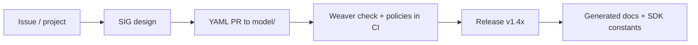
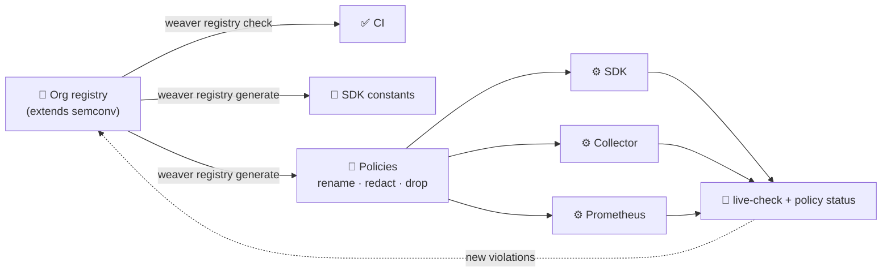
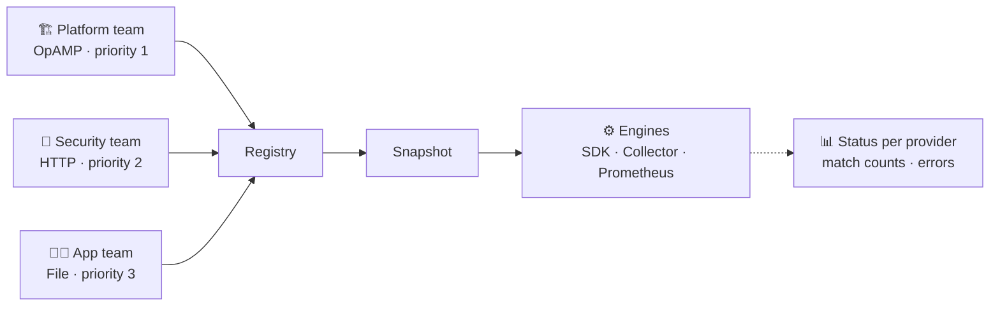

# What's the deal with Telemetry Quality?

### KubeCon + CloudNativeCon North America 2026

<div class="mt-6 text-sm opacity-70">Please raise your hands and ask lots of questions!</div>

---

# Jacob Aronoff

<div class="mt-6 grid grid-cols-[180px_1fr] gap-8 items-center">
  <div class="flex justify-center">
    
  </div>
  <div class="text-left space-y-3">
    <div class="rounded-lg border border-blue-200/35 bg-blue-50/10 px-3 py-2">
      <div class="text-[11px] uppercase tracking-wider opacity-75">Role</div>
      <div class="font-semibold">Founding Engineer at Tero</div>
    </div>
    <div class="rounded-lg border border-blue-200/35 bg-blue-50/10 px-3 py-2">
      <div class="text-[11px] uppercase tracking-wider opacity-75">Role</div>
      <div class="font-semibold">OpenTelemetry Maintainer</div>
      <div class="mt-2 grid grid-cols-2 gap-2 text-sm">
        <div class="rounded-md border border-slate-300/40 bg-slate-50/10 px-2 py-1">Operator</div>
        <div class="rounded-md border border-slate-300/40 bg-slate-50/10 px-2 py-1">Helm Charts</div>
        <div class="rounded-md border border-slate-300/40 bg-slate-50/10 px-2 py-1">OpAMP – Remote Agent Management</div>
        <div class="rounded-md border border-slate-300/40 bg-slate-50/10 px-2 py-1">Policies</div>
      </div>
    </div>
    <div class="rounded-lg border border-blue-200/35 bg-blue-50/10 px-3 py-2">
      <div class="text-[11px] uppercase tracking-wider opacity-75">Contact</div>
      <div class="font-semibold text-sm">jacob@usetero.com</div>
    </div>
  </div>
</div>

---
layout: center
class: text-center
---

# Quick Poll

<div class="mt-6 grid gap-3 text-left text-lg max-w-3xl mx-auto">
  <div v-click class="rounded-xl border border-blue-200 bg-blue-50 p-4">Who has been paged and the telemetry <strong>did not help</strong>?</div>
  <div v-click class="rounded-xl border border-violet-200 bg-violet-50 p-4">Who has <strong>dropped data during an incident</strong> to keep a pipeline alive?</div>
  <div v-click class="rounded-xl border border-rose-200 bg-rose-50 p-4">Who has found <strong>PII in their logs</strong> this year?</div>
</div>

<!--
Keep hands up through all three. Call out the people who still have hands up at the end.
-->

---
transition: fade
---

# Agenda

<div class="cd-timeline">
  <span class="cd-chip cd-chip-active">Why Quality</span>
  <span class="cd-timeline-line"></span>
  <span class="cd-chip cd-chip-inactive">Incident</span>
  <span class="cd-timeline-line"></span>
  <span class="cd-chip cd-chip-inactive">Semconv</span>
  <span class="cd-timeline-line"></span>
  <span class="cd-chip cd-chip-inactive">Weaver</span>
  <span class="cd-timeline-line"></span>
  <span class="cd-chip cd-chip-inactive">Gaps</span>
  <span class="cd-timeline-line"></span>
  <span class="cd-chip cd-chip-inactive">Policies</span>
</div>

- Why telemetry quality matters
- An incident, told through bad telemetry
- Semantic conventions: what they are and how OTel makes them
- Weaver: enforce conventions across the org
- What the ecosystem is still missing
- Policies: enforcement everywhere telemetry flows

---

# Why Is Telemetry Quality Important?

<div class="grid grid-cols-3 gap-5 text-left text-[13px] leading-5 mt-2">
  <div
    v-motion
    :initial="{ y: 20, opacity: 0 }"
    :enter="{ y: 0, opacity: 1, transition: { duration: 500 } }"
    class="rounded-xl cd-cost-card cd-cost-card-red p-4"
  >
    <h3 class="text-sm uppercase tracking-wider cd-cost-title mb-3">Noise ruins Signal</h3>
    <div class="border-l-2 cd-cost-track pl-3 space-y-3">
      <p v-click class="relative"><span class="absolute -left-[17px] top-1.5 w-2 h-2 rounded-full cd-cost-dot" />Pipelines, quotas and budgets are shared.</p>
      <p v-click class="relative"><span class="absolute -left-[17px] top-1.5 w-2 h-2 rounded-full cd-cost-dot" />A spike of debug logs competes with your error logs.</p>
      <p v-click class="relative"><span class="absolute -left-[17px] top-1.5 w-2 h-2 rounded-full cd-cost-dot-strong" /><span v-mark.red>Useless telemetry volume degrades the good stuff.</span></p>
    </div>
  </div>

  <div
    v-motion
    :initial="{ y: 20, opacity: 0 }"
    :enter="{ y: 0, opacity: 1, transition: { duration: 500, delay: 150 } }"
    class="rounded-xl cd-cost-card cd-cost-card-orange p-4"
  >
    <h3 class="text-sm uppercase tracking-wider cd-cost-title mb-3">Attribution Links Data</h3>
    <div class="border-l-2 cd-cost-track pl-3 space-y-3">
      <p v-click class="relative"><span class="absolute -left-[17px] top-1.5 w-2 h-2 rounded-full cd-cost-dot" />Logs, metrics, traces and profiles come from different emitters.</p>
      <p v-click class="relative"><span class="absolute -left-[17px] top-1.5 w-2 h-2 rounded-full cd-cost-dot" />Shared keys (<code>service.name</code>, <code>k8s.pod.name</code>) are the join.</p>
      <p v-click class="relative"><span class="absolute -left-[17px] top-1.5 w-2 h-2 rounded-full cd-cost-dot-strong" /><span v-mark.orange>No consistent keys, no correlation.</span></p>
    </div>
  </div>

  <div
    v-motion
    :initial="{ y: 20, opacity: 0 }"
    :enter="{ y: 0, opacity: 1, transition: { duration: 500, delay: 300 } }"
    class="rounded-xl cd-cost-card cd-cost-card-purple p-4"
  >
    <h3 class="text-sm uppercase tracking-wider cd-cost-title mb-3">No PII Leaks</h3>
    <div class="border-l-2 cd-cost-track pl-3 space-y-3">
      <p v-click class="relative"><span class="absolute -left-[17px] top-1.5 w-2 h-2 rounded-full cd-cost-dot" />One <code>log.info(user)</code> ships emails to a vendor.</p>
      <p v-click class="relative"><span class="absolute -left-[17px] top-1.5 w-2 h-2 rounded-full cd-cost-dot" />Telemetry is copied, indexed, retained and shared widely.</p>
      <p v-click class="relative"><span class="absolute -left-[17px] top-1.5 w-2 h-2 rounded-full cd-cost-dot-strong" /><span v-mark.purple>Quality is a compliance problem too.</span></p>
    </div>
  </div>
</div>

---

# 🔍 Spot the Problems

One log record from "production". Shout them out.

<div class="grid grid-cols-[1.2fr_1fr] gap-6 mt-2 text-left">
<div>

```json
{
  "severity_text": "DEBUG",
  "body": "checkout ok for jane.doe@example.com",
  "attributes": {
    "svc": "checkout",
    "pod": "checkout-7d9f-xk2p",
    "user_id": "u_83749123",
    "http.method": "POST",
    "card": "4111 1111 1111 1111"
  }
}
```

</div>
<div class="grid gap-2 text-xs">
  <div v-click class="rounded-lg border border-red-200 bg-red-50 p-2"><code>DEBUG</code> in prod: pure volume.</div>
  <div v-click class="rounded-lg border border-rose-200 bg-rose-50 p-2">Email in the body: PII.</div>
  <div v-click class="rounded-lg border border-orange-200 bg-orange-50 p-2"><code>svc</code> should be the <code>service.name</code> resource attribute.</div>
  <div v-click class="rounded-lg border border-orange-200 bg-orange-50 p-2"><code>pod</code> should be <code>k8s.pod.name</code>.</div>
  <div v-click class="rounded-lg border border-amber-200 bg-amber-50 p-2"><code>user_id</code>: high cardinality and identifying.</div>
  <div v-click class="rounded-lg border border-violet-200 bg-violet-50 p-2"><code>http.method</code> is deprecated: use <code>http.request.method</code>.</div>
  <div v-click class="rounded-lg border border-red-200 bg-red-50 p-2 font-semibold">Why is there a card number in there??</div>
</div>
</div>

<!--
Let the room find as many as possible before clicking through. Count how many they get.
-->

---
transition: fade
---

# Poor Telemetry Quality: An Incident

<div class="cd-timeline">
  <span class="cd-chip cd-chip-inactive">Why Quality</span>
  <span class="cd-timeline-line"></span>
  <span class="cd-chip cd-chip-active">Incident</span>
  <span class="cd-timeline-line"></span>
  <span class="cd-chip cd-chip-inactive">Semconv</span>
  <span class="cd-timeline-line"></span>
  <span class="cd-chip cd-chip-inactive">Weaver</span>
  <span class="cd-timeline-line"></span>
  <span class="cd-chip cd-chip-inactive">Gaps</span>
  <span class="cd-timeline-line"></span>
  <span class="cd-chip cd-chip-inactive">Policies</span>
</div>

<div class="mt-2 space-y-3 text-left">
  <div class="rounded-lg border border-slate-300 p-3" v-click>
    <div class="flex items-center justify-between text-sm">
      <strong>1. 02:14: checkout p99 latency alert fires</strong>
      <span class="opacity-70">Pipeline load: 1x</span>
    </div>
    <div class="mt-2 h-3 bg-slate-200 rounded"><div class="h-3 w-[30%] bg-blue-500 rounded"></div></div>
    <div class="mt-2 text-xs opacity-80">Every service starts to log retries and stack traces.</div>
  </div>

  <div class="rounded-lg border border-slate-300 p-3" v-click>
    <div class="flex items-center justify-between text-sm">
      <strong>2. 02:20: investigation goes nowhere</strong>
      <span class="opacity-70">Pipeline load: 8x</span>
    </div>
    <div class="mt-2 h-3 bg-slate-200 rounded"><div class="h-3 w-[95%] bg-red-500 rounded"></div></div>
    <div class="mt-2 text-xs opacity-80">Collectors back up and refuse data. Ingest lags 15 minutes. Queries time out.</div>
  </div>

  <div class="rounded-lg border border-slate-300 p-3" v-click>
    <div class="flex items-center justify-between text-sm">
      <strong>3. 02:45: cut the volume</strong>
      <span class="opacity-70">Pipeline load: 2x</span>
    </div>
    <div class="mt-2 h-3 bg-slate-200 rounded"><div class="h-3 w-[45%] bg-orange-500 rounded"></div></div>
    <div class="mt-2 text-xs opacity-80">Emergency sample to 10%. <span v-mark.red>The error logs you needed are in the 90%.</span></div>
  </div>
</div>

---

# 03:30: The Data Is Finally Here. Now What?

"Which checkout pods are hurt by the node issues?"

<div class="grid grid-cols-3 gap-4 mt-4 text-left text-sm">
  <div v-click class="rounded-xl border border-blue-200 bg-blue-50 p-4">
    <div class="text-xs uppercase tracking-wider text-blue-700 mb-2">Infra metrics (Prometheus)</div>
    <div class="font-mono text-xs space-y-1">
      <div>namespace="shop"</div>
      <div>pod="checkout-7d9f-xk2p"</div>
      <div>node="ip-10-0-3-12"</div>
    </div>
  </div>
  <div v-click class="rounded-xl border border-violet-200 bg-violet-50 p-4">
    <div class="text-xs uppercase tracking-wider text-violet-700 mb-2">App metrics (OTel SDK)</div>
    <div class="font-mono text-xs space-y-1">
      <div>service.name="checkout-svc"</div>
      <div>host.name="checkout-7d9f-xk2p"</div>
      <div class="opacity-50">no k8s.* attributes</div>
    </div>
  </div>
  <div v-click class="rounded-xl border border-emerald-200 bg-emerald-50 p-4">
    <div class="text-xs uppercase tracking-wider text-emerald-700 mb-2">Logs (Fluent Bit)</div>
    <div class="font-mono text-xs space-y-1">
      <div>kubernetes.namespace_name="shop"</div>
      <div>kubernetes.pod_name="checkout-7d9f-xk2p"</div>
      <div>kubernetes.host="ip-10-0-3-12"</div>
    </div>
  </div>
</div>

<div v-click class="mt-6 rounded-xl border border-red-200 bg-red-50 p-4 text-left">
  Three emitters, three names for the same pod. Every join is a hand-written regex at 3am.
  <span v-mark.red>You cannot tell which apps are most affected by the infra.</span>
</div>

---
layout: center
class: text-center
---

# 🙋 Poll: How Many Names Does "Service" Have in Your Org?

<div class="mt-8 grid grid-cols-3 gap-6 max-w-4xl mx-auto text-xl">
  <div class="rounded-xl border border-emerald-200 bg-emerald-50 p-6">1</div>
  <div class="rounded-xl border border-amber-200 bg-amber-50 p-6">2 – 3</div>
  <div class="rounded-xl border border-red-200 bg-red-50 p-6">4+</div>
</div>

<div v-click class="mt-8 text-sm opacity-75 font-mono">
  service · service.name · svc · app · app.kubernetes.io/name · job · component · k8s-app
</div>

<!--
Ask someone with 4+ to share their worst one.
-->

---
transition: fade
---

# What Is a Semantic Convention?

<div class="cd-timeline">
  <span class="cd-chip cd-chip-inactive">Why Quality</span>
  <span class="cd-timeline-line"></span>
  <span class="cd-chip cd-chip-inactive">Incident</span>
  <span class="cd-timeline-line"></span>
  <span class="cd-chip cd-chip-active">Semconv</span>
  <span class="cd-timeline-line"></span>
  <span class="cd-chip cd-chip-inactive">Weaver</span>
  <span class="cd-timeline-line"></span>
  <span class="cd-chip cd-chip-inactive">Gaps</span>
  <span class="cd-timeline-line"></span>
  <span class="cd-chip cd-chip-inactive">Policies</span>
</div>

<div class="grid grid-cols-2 gap-6 mt-2 text-left">
  <div class="text-sm space-y-3">
    <div class="rounded-xl border border-blue-200 bg-blue-50 p-4">
      A shared vocabulary: <strong>common names, types, units and meanings</strong> for the operations and data your systems emit.
    </div>
    <div class="rounded-xl border border-slate-300 p-4">
      Covers every signal: traces, metrics, logs, profiles and resources.
    </div>
    <div class="rounded-xl border border-slate-300 p-4">
      Defines <strong>requirement levels</strong>: required, conditionally required, recommended, opt-in.
    </div>
  </div>
  <div>

```yaml
# resource
service.name: checkout
k8s.namespace.name: shop
k8s.pod.name: checkout-7d9f-xk2p

# span attributes
http.request.method: POST
http.response.status_code: 503
url.path: /api/checkout

# metric
http.server.request.duration  # unit: s
```

  </div>
</div>

---

# Why Does This Matter?

<div class="grid grid-cols-2 gap-5 mt-4 text-left text-sm">
  <div v-click class="rounded-xl border border-blue-200 bg-blue-50 p-4">
    <div class="font-semibold mb-2">Correlation for free</div>
    <div class="opacity-80">Same keys on infra and app data, so a pod in a metric is the same pod in a span and a log.</div>
  </div>
  <div v-click class="rounded-xl border border-violet-200 bg-violet-50 p-4">
    <div class="font-semibold mb-2">Portable dashboards and alerts</div>
    <div class="opacity-80">Backends and vendors build curated views on known names. Switch tools without a rewrite.</div>
  </div>
  <div v-click class="rounded-xl border border-emerald-200 bg-emerald-50 p-4">
    <div class="font-semibold mb-2">Instrumentation agrees with itself</div>
    <div class="opacity-80">Auto-instrumentation in Java, Go, Python and .NET emits the same shape for the same operation.</div>
  </div>
  <div v-click class="rounded-xl border border-amber-200 bg-amber-50 p-4">
    <div class="font-semibold mb-2">Humans and AI can reason about it</div>
    <div class="opacity-80">An on-call engineer, or an agent, can query <code>http.response.status_code</code> without guessing.</div>
  </div>
</div>

---

# How Does OTel Develop Them?

<div class="grid grid-cols-3 gap-4 mt-2 text-left text-sm">
  <div class="rounded-xl border border-blue-200 bg-blue-50 p-4">
    <div class="text-xs uppercase tracking-wider text-blue-700 mb-2">Model</div>
    <div class="font-semibold mb-1">YAML is the source of truth</div>
    <div class="opacity-80">87 namespaces in <code>model/</code>: <code>http</code>, <code>db</code>, <code>k8s</code>, <code>gen-ai</code>, <code>cicd</code>… Docs and code are generated from it.</div>
  </div>
  <div class="rounded-xl border border-violet-200 bg-violet-50 p-4">
    <div class="text-xs uppercase tracking-wider text-violet-700 mb-2">People</div>
    <div class="font-semibold mb-1">Area SIGs own domains</div>
    <div class="opacity-80">K8s, System, CI/CD, Security, RPC, Network, Browser… Each SIG drives its area toward stable.</div>
  </div>
  <div class="rounded-xl border border-emerald-200 bg-emerald-50 p-4">
    <div class="text-xs uppercase tracking-wider text-emerald-700 mb-2">Lifecycle</div>
    <div class="font-semibold mb-1">Stability + schema URLs</div>
    <div class="opacity-80">Every group has a stability level. Each release has a schema URL, so data can declare which version it follows.</div>
  </div>
</div>



<div class="mt-2 text-xs opacity-70">
  Latest: <code>v1.44.0</code> (Aug 2026). Most SIGs are looking for contributors:
  <a href="https://github.com/open-telemetry/semantic-conventions/blob/main/AREAS.md" target="_blank">AREAS.md</a>
</div>

---

# Weaver: Observability by Design

<div class="cd-timeline">
  <span class="cd-chip cd-chip-inactive">Why Quality</span>
  <span class="cd-timeline-line"></span>
  <span class="cd-chip cd-chip-inactive">Incident</span>
  <span class="cd-timeline-line"></span>
  <span class="cd-chip cd-chip-inactive">Semconv</span>
  <span class="cd-timeline-line"></span>
  <span class="cd-chip cd-chip-active">Weaver</span>
  <span class="cd-timeline-line"></span>
  <span class="cd-chip cd-chip-inactive">Gaps</span>
  <span class="cd-timeline-line"></span>
  <span class="cd-chip cd-chip-inactive">Policies</span>
</div>

<div class="grid grid-cols-[1.4fr_1fr] gap-5 mt-1 text-left">
<div style="--slidev-code-font-size: 0.62rem">

Treat telemetry like a **public API**. Your org gets its own registry that extends OTel semconv.

```yaml [manifest.yaml]
name: acme
schema_url: https://acme.com/schemas/1.2.0
dependencies:
  - schema_url: https://opentelemetry.io/schemas/1.44.0
    registry_path: https://github.com/open-telemetry/semantic-conventions@v1.44.0[model]
```

</div>
<div class="grid gap-2 text-xs">
  <div v-click class="rounded-lg border border-blue-200 bg-blue-50 p-2"><code>weaver registry check -p ./policies</code><br>Validate the registry and custom Rego rules in CI.</div>
  <div v-click class="rounded-lg border border-violet-200 bg-violet-50 p-2"><code>weaver registry generate</code><br>Generate typed constants, helpers and docs from templates.</div>
  <div v-click class="rounded-lg border border-amber-200 bg-amber-50 p-2"><code>weaver registry diff</code><br>Catch breaking telemetry changes between versions.</div>
  <div v-click class="rounded-lg border border-emerald-200 bg-emerald-50 p-2"><code>weaver registry live-check</code><br>Receive real OTLP and report violations against the registry.</div>
  <div v-click class="rounded-lg border border-slate-300 p-2"><code>emit</code> · <code>infer</code> · <code>mcp</code><br>Sample data, schema inference from OTLP, and an MCP server for agents.</div>
</div>
</div>

<div class="mt-2 text-xs opacity-70">
  <a href="https://github.com/open-telemetry/weaver" target="_blank">github.com/open-telemetry/weaver</a> · latest <code>v0.28.0</code>
</div>

---
layout: center
class: text-center
---

# Poll: How do you know what telemetry you emit today?

<div class="mt-8 grid grid-cols-2 gap-4 max-w-4xl mx-auto text-lg text-left">
  <div class="rounded-xl border border-blue-200 bg-blue-50 p-4">In code review, by eye</div>
  <div class="rounded-xl border border-violet-200 bg-violet-50 p-4">In CI, with a tool like Weaver</div>
  <div class="rounded-xl border border-emerald-200 bg-emerald-50 p-4">In the pipeline, with processors</div>
  <div class="rounded-xl border border-red-200 bg-red-50 p-4">In the bill, at the end of the month</div>
</div>

<!--
Most rooms land on "code review" and "the bill". Use that to set up the gaps section.
-->

---
transition: fade
---

# What Is Missing in the Ecosystem?

<div class="cd-timeline">
  <span class="cd-chip cd-chip-inactive">Why Quality</span>
  <span class="cd-timeline-line"></span>
  <span class="cd-chip cd-chip-inactive">Incident</span>
  <span class="cd-timeline-line"></span>
  <span class="cd-chip cd-chip-inactive">Semconv</span>
  <span class="cd-timeline-line"></span>
  <span class="cd-chip cd-chip-inactive">Weaver</span>
  <span class="cd-timeline-line"></span>
  <span class="cd-chip cd-chip-active">Gaps</span>
  <span class="cd-timeline-line"></span>
  <span class="cd-chip cd-chip-inactive">Policies</span>
</div>

<div class="grid grid-cols-3 gap-5 text-left text-[13px] leading-5 mt-2">
  <div
    v-motion
    :initial="{ y: 20, opacity: 0 }"
    :enter="{ y: 0, opacity: 1, transition: { duration: 500 } }"
    class="rounded-xl cd-cost-card cd-cost-card-red p-4"
  >
    <h3 class="text-sm uppercase tracking-wider cd-cost-title mb-3">Consistent Application</h3>
    <div class="border-l-2 cd-cost-track pl-3 space-y-3">
      <p v-click class="relative"><span class="absolute -left-[17px] top-1.5 w-2 h-2 rounded-full cd-cost-dot" />Weaver guards the code you own and build.</p>
      <p v-click class="relative"><span class="absolute -left-[17px] top-1.5 w-2 h-2 rounded-full cd-cost-dot" />Vendor agents, exporters, legacy apps and third-party charts never go through your CI.</p>
      <p v-click class="relative"><span class="absolute -left-[17px] top-1.5 w-2 h-2 rounded-full cd-cost-dot-strong" /><span v-mark.red>Live-check reports. It does not enforce.</span></p>
    </div>
  </div>

  <div
    v-motion
    :initial="{ y: 20, opacity: 0 }"
    :enter="{ y: 0, opacity: 1, transition: { duration: 500, delay: 150 } }"
    class="rounded-xl cd-cost-card cd-cost-card-orange p-4"
  >
    <h3 class="text-sm uppercase tracking-wider cd-cost-title mb-3">Performant Transformation</h3>
    <div class="border-l-2 cd-cost-track pl-3 space-y-3">
      <p v-click class="relative"><span class="absolute -left-[17px] top-1.5 w-2 h-2 rounded-full cd-cost-dot" />Fixing names in flight means OTTL, relabel rules, VRL, Lua…</p>
      <p v-click class="relative"><span class="absolute -left-[17px] top-1.5 w-2 h-2 rounded-full cd-cost-dot" />Each rule runs one after another. 10 is fine. 10,000 is not.</p>
      <p v-click class="relative"><span class="absolute -left-[17px] top-1.5 w-2 h-2 rounded-full cd-cost-dot-strong" /><span v-mark.orange>So teams drop data instead of fixing it.</span></p>
    </div>
  </div>

  <div
    v-motion
    :initial="{ y: 20, opacity: 0 }"
    :enter="{ y: 0, opacity: 1, transition: { duration: 500, delay: 300 } }"
    class="rounded-xl cd-cost-card cd-cost-card-purple p-4"
  >
    <h3 class="text-sm uppercase tracking-wider cd-cost-title mb-3">Governance Controls</h3>
    <div class="border-l-2 cd-cost-track pl-3 space-y-3">
      <p v-click class="relative"><span class="absolute -left-[17px] top-1.5 w-2 h-2 rounded-full cd-cost-dot" />Who owns a rule? Who can override it? Did it ever match?</p>
      <p v-click class="relative"><span class="absolute -left-[17px] top-1.5 w-2 h-2 rounded-full cd-cost-dot" />Platform, security and app teams all edit the same YAML file.</p>
      <p v-click class="relative"><span class="absolute -left-[17px] top-1.5 w-2 h-2 rounded-full cd-cost-dot-strong" /><span v-mark.purple>No priority, no audit, no feedback.</span></p>
    </div>
  </div>
</div>

<div v-click class="mt-4 text-sm opacity-75">
  Design time is solved-ish. <strong>Run time</strong> is where quality is lost.
</div>

---

# Same Fix, Four Languages

Intent: rename `pod` to `k8s.pod.name` everywhere.

<div class="grid grid-cols-2 gap-4 text-left mt-2">
<div>

```yaml [OTTL]
transform:
  log_statements:
    - set(attributes["k8s.pod.name"], attributes["pod"])
    - delete_key(attributes, "pod")
```

</div>
<div>

```yaml [Prometheus]
metric_relabel_configs:
  - source_labels: [pod]
    target_label: k8s_pod_name
  - regex: pod
    action: labeldrop
```

</div>
<div>

```toml [VRL]
[transforms.rename_pod]
type = "remap"
inputs = ["source"]
source = '.k8s.pod.name = del(.pod)'
```

</div>
<div>

```lua [Fluent Bit Lua]
function cb(tag, ts, record)
  record["k8s.pod.name"] = record["pod"]
  record["pod"] = nil
  return 1, ts, record
end
```

</div>
</div>

<div v-click class="mt-2 text-xs opacity-75">Now multiply by every attribute in your registry and every team that owns a pipeline.</div>

---
transition: fade
---

# What Are Policies?

<div class="cd-timeline">
  <span class="cd-chip cd-chip-inactive">Why Quality</span>
  <span class="cd-timeline-line"></span>
  <span class="cd-chip cd-chip-inactive">Incident</span>
  <span class="cd-timeline-line"></span>
  <span class="cd-chip cd-chip-inactive">Semconv</span>
  <span class="cd-timeline-line"></span>
  <span class="cd-chip cd-chip-inactive">Weaver</span>
  <span class="cd-timeline-line"></span>
  <span class="cd-chip cd-chip-inactive">Gaps</span>
  <span class="cd-timeline-line"></span>
  <span class="cd-chip cd-chip-active">Policies</span>
</div>

<div class="grid grid-cols-3 gap-4 mt-2 text-left text-sm">
  <div class="rounded-xl border border-blue-200 bg-blue-50 p-4">
    <div class="text-xs uppercase tracking-wider text-blue-700 mb-2">Contract</div>
    <div class="font-semibold">Atomic intent</div>
    <div class="opacity-80">One matcher set + one action set.</div>
  </div>
  <div class="rounded-xl border border-violet-200 bg-violet-50 p-4">
    <div class="text-xs uppercase tracking-wider text-violet-700 mb-2">Typing</div>
    <div class="font-semibold">One signal target</div>
    <div class="opacity-80"><code>log</code> / <code>metric</code> / <code>trace</code> via <code>oneof</code>.</div>
  </div>
  <div class="rounded-xl border border-emerald-200 bg-emerald-50 p-4">
    <div class="text-xs uppercase tracking-wider text-emerald-700 mb-2">Portability</div>
    <div class="font-semibold">OTel data model fields</div>
    <div class="opacity-80">Same behavior in SDK, Collector, Prometheus, proxy.</div>
  </div>
</div>

<div class="grid grid-cols-2 gap-4 mt-4 text-left text-sm">
  <div class="rounded-xl border border-slate-300 p-4">
    <div class="font-semibold mb-2">Two stages, fixed order</div>
    <div class="opacity-80"><strong>Keep</strong>: all, none, <code>10%</code>, <code>100/s</code>. Most restrictive wins.</div>
    <div class="opacity-80"><strong>Transform</strong>: remove → redact → rename → add.</div>
  </div>
  <div class="rounded-xl border border-slate-300 p-4">
    <div class="font-semibold mb-2">Spec guarantees</div>
    <div class="flex flex-wrap gap-2">
      <span class="cd-pill">self-contained</span>
      <span class="cd-pill">idempotent</span>
      <span class="cd-pill">fail-open</span>
      <span class="cd-pill">deterministic</span>
    </div>
  </div>
</div>

---

# Policies That Fix Quality

<div class="grid grid-cols-2 gap-4 text-left">
<div>

```json [semconv-k8s-pod.policy.json]
{
  "id": "semconv-k8s-pod",
  "name": "Normalize pod to semconv",
  "log": {
    "match": [
      { "log_attribute": ["pod"], "exists": true }
    ],
    "transform": {
      "rename": [
        { "log_attribute": ["pod"],
          "to": "k8s.pod.name" }
      ]
    }
  }
}
```

</div>
<div>

```json [redact-ccs.policy.json]
{
  "id": "redact-ccs",
  "name": "Redact credit card numbers",
  "log": {
    "match": [
      { "log_attribute": ["ccn"], "exists": true }
    ],
    "transform": {
      "redact": [
        { "log_attribute": ["ccn"] }
      ]
    }
  }
}
```

</div>
</div>

<div class="mt-2 text-xs opacity-75">
  Transforms are defined for logs today. Metric renames and aggregation are proposed next stages.
</div>

---

# Weaver + Policies: Design Time Meets Run Time



<div class="grid grid-cols-3 gap-3 mt-3 text-xs text-left">
  <div v-click class="rounded-lg border border-blue-200 bg-blue-50 p-3">The registry is the one source of truth for names, types and sensitive fields.</div>
  <div v-click class="rounded-lg border border-violet-200 bg-violet-50 p-3">Weaver templates can render policies, the same way they render code and docs.</div>
  <div v-click class="rounded-lg border border-emerald-200 bg-emerald-50 p-3">Policies enforce the registry on telemetry you do not own.</div>
</div>

---

# Governance



<div class="grid grid-cols-2 gap-3 mt-3 text-sm text-left">
  <div v-click class="rounded-lg border border-blue-200 bg-blue-50 p-3"><strong>Provider priority:</strong> same policy ID from two providers? The higher priority wins.</div>
  <div v-click class="rounded-lg border border-violet-200 bg-violet-50 p-3"><strong>Commutative merge:</strong> conflicting keep rules resolve to the most restrictive.</div>
  <div v-click class="rounded-lg border border-emerald-200 bg-emerald-50 p-3"><strong>Status feedback:</strong> each provider sees match counts and errors for its own policies.</div>
  <div v-click class="rounded-lg border border-amber-200 bg-amber-50 p-3"><strong>Fail-open:</strong> a bad policy never takes down the pipeline.</div>
</div>

---

# Performance

<div class="grid grid-cols-2 gap-6 items-center mt-2">
  <div class="text-left text-sm grid gap-2">
    <div v-click class="rounded-lg border border-blue-200 bg-blue-50 p-3">Compile all policy matchers ahead of time into Hyperscan databases, grouped by field.</div>
    <div v-click class="rounded-lg border border-violet-200 bg-violet-50 p-3">One pass per field matches every policy at once: no sequential rule chain.</div>
    <div v-click class="rounded-lg border border-amber-200 bg-amber-50 p-3">Preallocated scratch memory: no allocations on the hot path.</div>
    <div v-click class="rounded-lg border border-slate-300 p-3">Cost grows with record size, not with the number of policies.</div>
  </div>
  <div class="flex justify-center">
    
  </div>
</div>

<!--
TODO: add current numbers (records/sec at 10 / 1k / 10k policies, OTTL baseline).
-->

---

# Policies: Adoption & Roadmap

<div class="grid grid-cols-2 gap-5 mt-4 text-left text-sm">
  <div class="rounded-xl border border-blue-200 bg-blue-50 p-4">
    <div class="text-xs uppercase tracking-wider text-blue-700 mb-2">Official</div>
    <div class="font-semibold mb-2">Part of OpenTelemetry</div>
    <div class="opacity-80">Telemetry policies are officially part of OpenTelemetry.</div>
  </div>
  <div class="rounded-xl border border-violet-200 bg-violet-50 p-4">
    <div class="text-xs uppercase tracking-wider text-violet-700 mb-2">Native implementations</div>
    <div class="font-semibold mb-2">Google, Elastic &amp; more</div>
    <div class="opacity-80">Companies are implementing policies natively, including in Google Cloud (GCP).</div>
  </div>
  <div class="rounded-xl border border-emerald-200 bg-emerald-50 p-4">
    <div class="text-xs uppercase tracking-wider text-emerald-700 mb-2">Libraries</div>
    <div class="font-semibold mb-2">Go, Rust, Zig</div>
    <div class="opacity-80"><code>usetero/policy-go</code>, <code>policy-rs</code>, <code>policy-zig</code>. Collector and SDK integrations underway.</div>
  </div>
  <div class="rounded-xl border border-amber-200 bg-amber-50 p-4">
    <div class="text-xs uppercase tracking-wider text-amber-700 mb-2">Next</div>
    <div class="font-semibold mb-2">More stages</div>
    <div class="opacity-80">Metric renames, aggregation and span rollups follow the same spec process.</div>
  </div>
</div>

<div class="mt-4 text-xs opacity-70">
  <a href="https://github.com/open-telemetry/opentelemetry-specification/blob/main/oteps/4738-telemetry-policy.md" target="_blank" rel="noreferrer">OTEP 4738: Telemetry Policies</a>
</div>

---
layout: center
class: text-center
---

# 💬 Let's Discuss

<div class="mt-6 grid grid-cols-2 gap-4 max-w-4xl mx-auto text-left text-sm">
  <div class="rounded-xl border border-blue-200 bg-blue-50 p-4">Where should enforcement live: <strong>SDK, Collector, or backend</strong>?</div>
  <div class="rounded-xl border border-violet-200 bg-violet-50 p-4">Who owns your telemetry registry: <strong>platform, SRE, or each team</strong>?</div>
  <div class="rounded-xl border border-amber-200 bg-amber-50 p-4">A violation shows up in prod. Do you <strong>drop it, fix it, or flag it</strong>?</div>
  <div class="rounded-xl border border-emerald-200 bg-emerald-50 p-4">Which semconv area is <strong>missing</strong> for your workloads?</div>
</div>

---
layout: center
class: text-center
---

# Wrap Up

<div class="mt-4 text-left max-w-5xl mx-auto grid grid-cols-2 gap-4 text-sm">
  <div class="rounded-xl border border-blue-200 bg-blue-50 p-4">
    <div class="text-xs uppercase tracking-wide text-blue-700 font-semibold">Semantic Conventions</div>
    <a href="https://github.com/open-telemetry/semantic-conventions" target="_blank">open-telemetry/semantic-conventions</a>
  </div>
  <div class="rounded-xl border border-violet-200 bg-violet-50 p-4">
    <div class="text-xs uppercase tracking-wide text-violet-700 font-semibold">Weaver</div>
    <a href="https://github.com/open-telemetry/weaver" target="_blank">open-telemetry/weaver</a>
  </div>
  <div class="rounded-xl border border-emerald-200 bg-emerald-50 p-4">
    <div class="text-xs uppercase tracking-wide text-emerald-700 font-semibold">Policies</div>
    <a href="https://usetero.com/blog/policies-introduction" target="_blank">Introduction</a> ·
    <a href="https://usetero.com/blog/policies-deep-dive" target="_blank">Deep Dive</a>
  </div>
  <div class="rounded-xl border border-amber-200 bg-amber-50 p-4">
    <div class="text-xs uppercase tracking-wide text-amber-700 font-semibold">Tero</div>
    <a href="https://usetero.com" target="_blank">usetero.com</a> · We are hiring
  </div>
</div>

<div class="mt-8 text-2xl font-semibold">Questions?</div>
